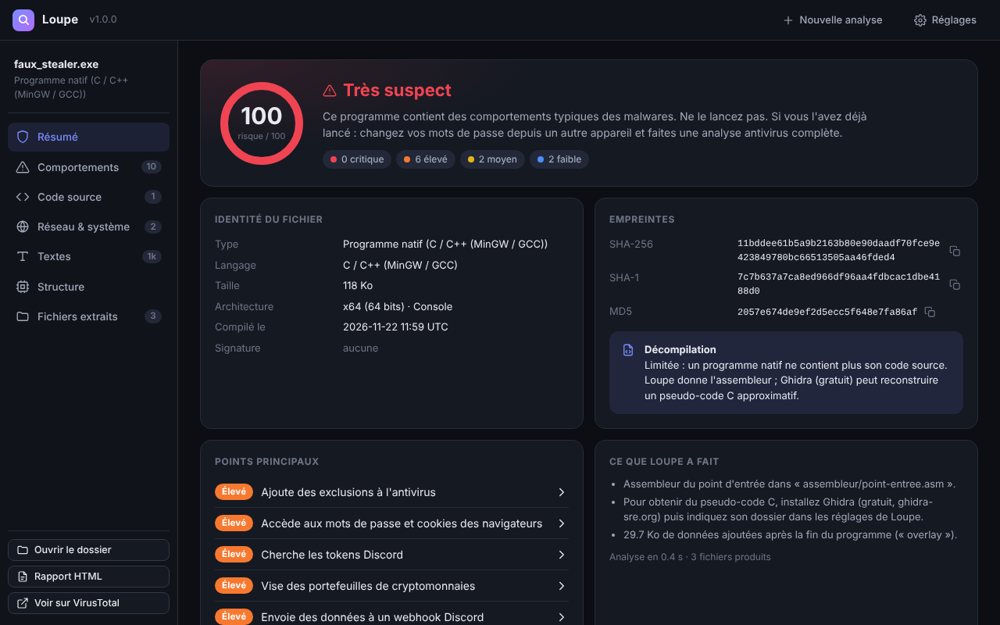
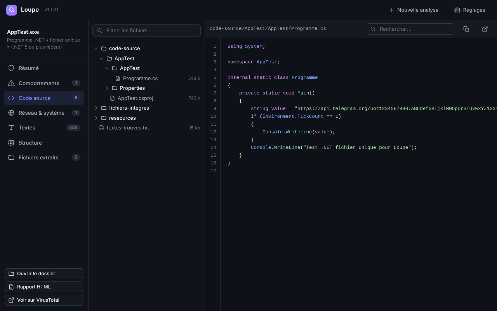

# Loupe

Analyse et décompilation de programmes Windows (.exe / .dll), **sans jamais les lancer**.

Glisse un programme dans la fenêtre : Loupe donne un verdict de sécurité (vol de mots de passe, tokens Discord, keylogger, injection, rançongiciel…) et récupère son code (C# pour .NET, Python pour PyInstaller, assembleur / pseudo-C pour le natif).




## Télécharger
Prends `Loupe.exe` dans l'onglet **Releases** (Windows 10/11 x64, rien à installer).

## Compiler
```
dotnet publish Loupe.App -c Release -o publish
```
SDK .NET 8. Version ligne de commande : `dotnet run --project Loupe.Cli -- fichier.exe`.

Les règles de détection sont dans `Loupe.Core/Regles/regles.json` : elles sont compressées à la compilation pour que Loupe ne contienne pas en clair les motifs qu'il recherche.

## Licence
Loupe est sous licence [MIT](LICENSE) : tu peux l'utiliser, le modifier et le redistribuer librement, en gardant la mention de copyright.

Bibliothèques utilisées (licence MIT) : [ICSharpCode.Decompiler](https://github.com/icsharpcode/ILSpy) (moteur d'ILSpy), [Iced](https://github.com/icedland/iced), [Microsoft WebView2](https://www.nuget.org/packages/Microsoft.Web.WebView2).

## Mode d'emploi complet

```
LOUPE 1.0 - analyse et décompilation de programmes Windows
==========================================================

DÉMARRER
  1. Double-cliquez sur Loupe.exe (rien à installer).
     Windows peut afficher « Windows a protégé votre ordinateur » : Loupe n'est pas signé
     (un certificat coûte cher). Cliquez sur « Informations complémentaires » puis « Exécuter quand même ».
  2. Glissez un .exe / .dll dans la fenêtre, ou cliquez sur « Choisir un fichier ».
  3. Lisez le verdict, puis explorez les onglets.

  Loupe ne LANCE JAMAIS le fichier analysé : il le lit comme un document.

CE QUE LOUPE FAIT
  - Verdict de sécurité : vol de mots de passe / cookies / tokens Discord / portefeuilles crypto,
    keylogger, injection de code, rançongiciel, désactivation de l'antivirus, démarrage caché,
    webhooks Discord, bots Telegram, serveurs en DNS dynamique, mineurs… (49 règles)
  - Décompilation selon le type de programme :
      .NET (C#, VB.NET)               -> code C# presque identique à l'original (moteur ILSpy intégré)
      .NET « fichier unique »         -> les DLL intégrées sont extraites et décompilées
      Python (PyInstaller)            -> scripts extraits ; code Python avec pycdc (voir OUTILS)
      Natif (C, C++, Rust, Go, Delphi)-> assembleur intégré ; pseudo-code C avec Ghidra (voir OUTILS)
      UPX                             -> décompressé si upx.exe est présent (voir OUTILS)
      Archive ZIP auto-extractible    -> contenu extrait
  - Réseau et système : adresses, IP, commandes, clés de registre trouvées dans le programme.
  - Structure : sections, entropie (compression/chiffrement), fonctions Windows, ressources, signature.
  - Rapport HTML à partager, et lien direct vers VirusTotal (par l'empreinte SHA-256, le fichier n'est pas envoyé).

OÙ SONT LES RÉSULTATS ?
  Dans Documents\Loupe\<nom du fichier>_<date>\ (modifiable dans Réglages).
    rapport.html          le rapport complet
    code-source\          le code décompilé
    textes-trouves.txt    tous les textes lisibles du fichier
  Par sécurité, les fichiers extraits qui pourraient se lancer d'un double-clic sont renommés
  (« setup.exe » devient « setup.exe.bin », « script.js » devient « script.js.txt »).

OUTILS FACULTATIFS (dossier « outils » à côté de Loupe.exe)
  - pycdc.exe : retraduit les fichiers .pyc en code Python lisible.
      Projet libre « Decompyle++ » : https://github.com/zrax/pycdc (à compiler, ou une version
      compilée de confiance). Sans lui, si Python est installé, Loupe montre le bytecode désassemblé.
  - upx.exe   : décompresse les programmes compressés avec UPX. https://upx.github.io
  - Ghidra    : pseudo-code C des programmes natifs. https://ghidra-sre.org (gratuit, demande Java 21).
      Indiquez son dossier dans Réglages.

LIMITES (à lire)
  - Une analyse sans exécution ne garantit jamais 100 %. Un malware bien protégé (VMProtect,
    Themida, code chiffré) peut cacher ce qu'il fait : Loupe le signale, mais ne voit pas dedans.
  - « À vérifier » ne veut pas dire « virus » : beaucoup d'outils système légitimes (optimiseurs,
    antivirus, utilitaires) utilisent PowerShell, le registre, etc.
  - En cas de doute, cherchez aussi l'empreinte SHA-256 sur VirusTotal.

CODE SOURCE
  Le dossier « code-source-de-Loupe » contient tout le code (C# + interface HTML).
  Les règles de détection sont dans Loupe.Core\Regles\regles.json (modifiables).
  Compiler : dotnet publish Loupe.App -c Release -o publish   (SDK .NET 8, sous Windows)
  Version ligne de commande : dotnet run --project Loupe.Cli -- fichier.exe
```
